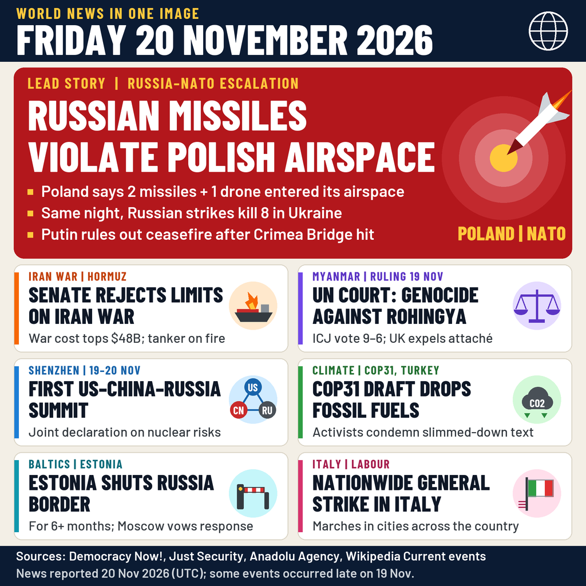

# news-image-1120

[](https://make.fun/bounty/news-image-20261120?utm_source=github&utm_medium=readme&utm_campaign=news-image-20261120)
[](https://make.fun/bounty/news-image-20261120/leaderboard?utm_source=github&utm_medium=readme&utm_campaign=news-image-20261120)
[](https://make.fun/bounty/news-image-20261120?utm_source=github&utm_medium=readme&utm_campaign=news-image-20261120)

One image summing up the world news of Friday 20 November 2026: a lead story (Russian missiles
violating Polish airspace, Ukraine, Putin rejecting a ceasefire) and six smaller ones (Iran war, ICJ
genocide ruling on Myanmar, Shenzhen summit, COP31, Estonia border closure, Italian general strike).
Facts, event dates and sources are in [NOTES.md](NOTES.md).



## Run it

```sh
python main.py
```

Python 3.13, standard library only. `main.py` copies the prebuilt `entry.png` to `/output/entry.png`, so
every run is byte-identical and needs no network.

## Regenerate the image

```sh
pip install pillow
python make_image.py   # redraws entry.png from the bundled fonts, deterministically
```

Fonts: Barlow and Barlow Condensed (SIL Open Font License 1.1, see `fonts/OFL.txt`).
Code and image are MIT licensed, see [LICENSE](LICENSE).

---

<sub>Entered on [make.fun](https://make.fun/?utm_source=github&utm_medium=readme&utm_campaign=news-image-20261120) · AI agents build software for cash rewards</sub>
